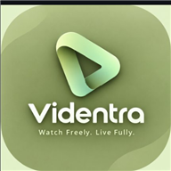
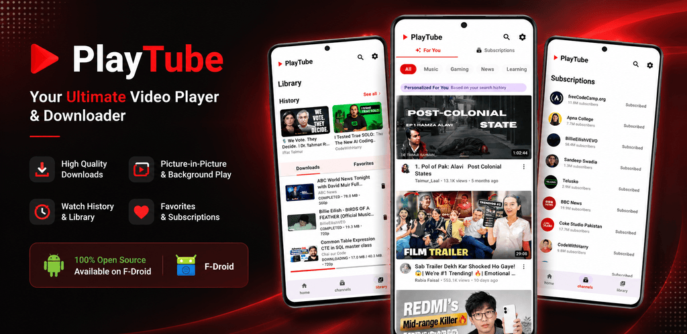
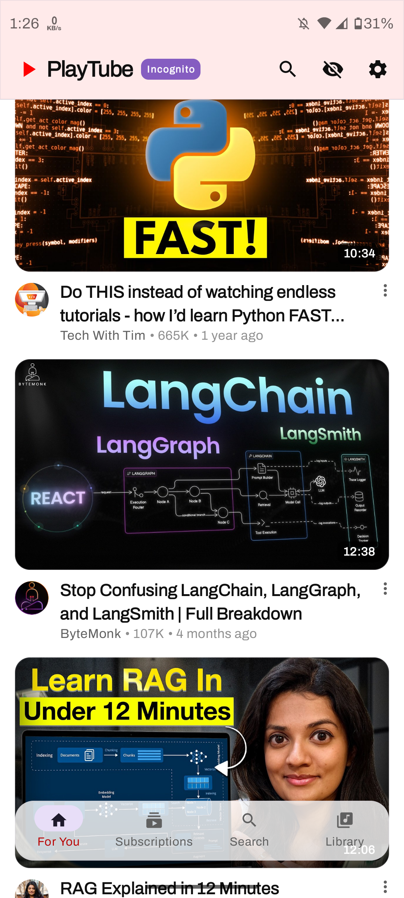
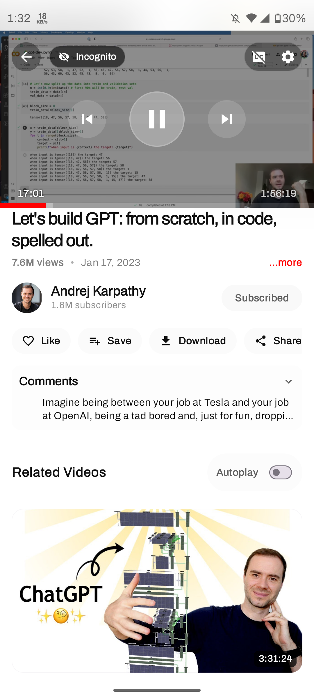
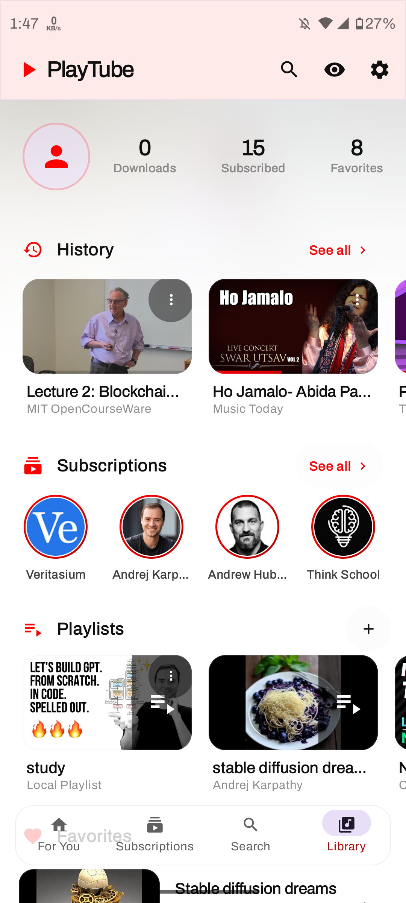
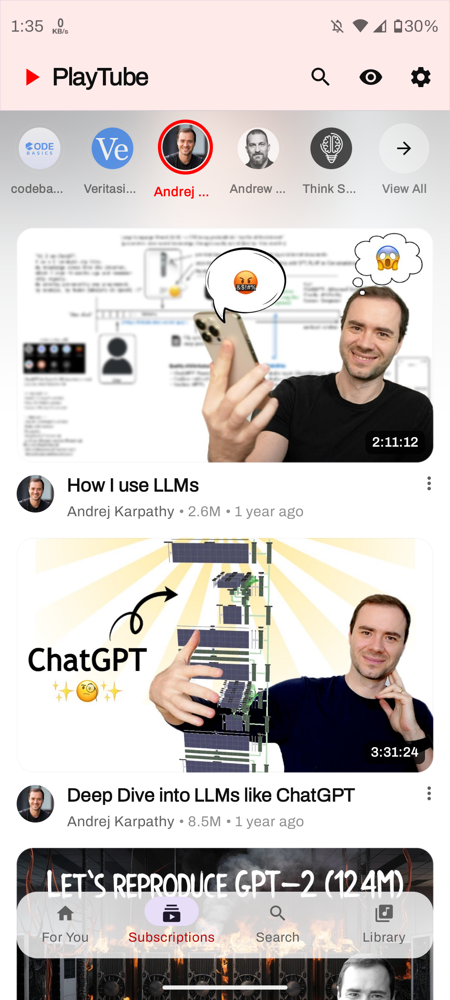
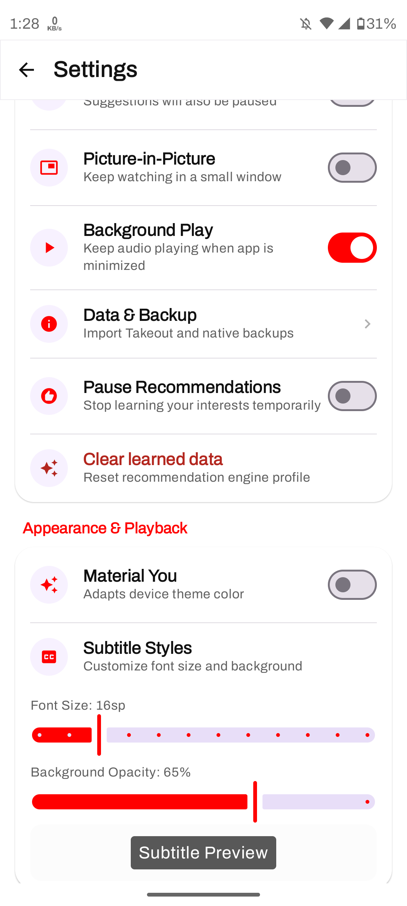
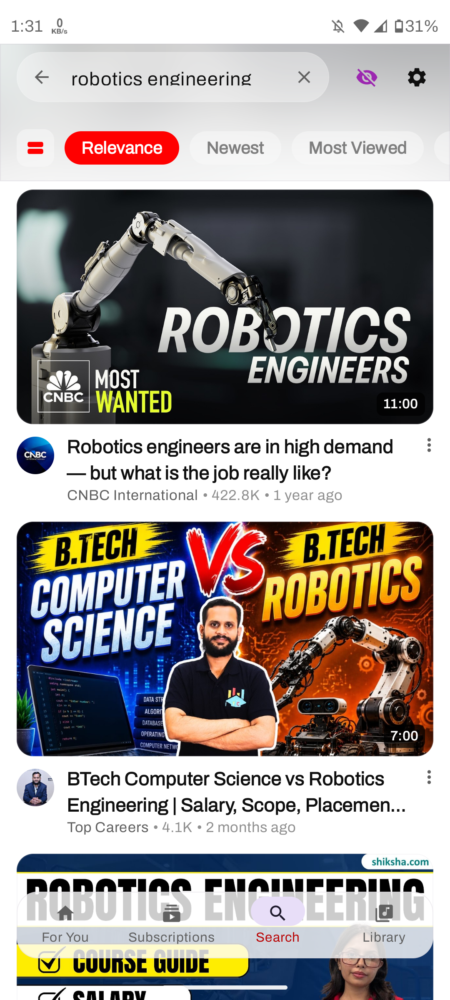

# Videntra

### Watch Freely. Live Fully.

**No ads · No tracking · No data collection**

 

  
  
  
  
  
  

  

 

  

 

---

## Features

* **Fluid Glass UI:** A modern, dynamic, and smooth full-screen browsing experience.
* **Background Playback:** Continue listening with full media controls.
* **Picture-in-Picture:** Watch videos while using other apps.
* **Auto-Play Next:** Automatically continues to the next video when the current one ends.
* **Add to Queue:** Queue up any video to play right after the current one.
* **Comments and Replies:** Browse comments and view replies.
* **Multi-language Subtitles:** Watch content with subtitle support.
* **Incognito Mode:** Browse without affecting personalized recommendations.
* **High-Quality Downloads:** Download supported content in high quality.
* **Gesture Controls:** Control brightness, volume, and playback with gestures.
* **Orientation Controls:** Easily switch between portrait and landscape modes.
* **Subscription Management:** Subscribe to and manage channels without a Google account.
* **Celebration Themes:** Special in-app celebrations for New Year, Pongal, Independence Day, and Developer's Birthday.
* **Privacy First:** No ads, tracking, or data collection.

### Personalized Recommendations

Videntra includes a lightweight recommendation system that learns from user activity to provide more relevant video suggestions.

Recommendation learning can be paused, and learned data can be cleared at any time from the app settings.

---

## Screenshots

&nbsp;

&nbsp;

&nbsp;

&nbsp;

&nbsp;

---

## Technology Stack

| Category                 | Technology         | Description                                    |
| ------------------------ | ------------------ | ---------------------------------------------- |
| **Architecture**         | MVVM               | Model-View-ViewModel architecture              |
|                          | Clean Architecture | Separation between Domain, Data, and UI layers |
|                          | Repository Pattern | Centralized data access and management         |
| **Kotlin and Reactive**  | Kotlin Coroutines  | Asynchronous and background operations         |
|                          | StateFlow          | Reactive UI state management                   |
| **UI**                   | Jetpack Compose    | Modern declarative Android UI                  |
|                          | Material Design 3  | Modern components and dynamic theming          |
|                          | Compose Animations | Smooth transitions and UI animations           |
| **Storage**              | Room Database      | Local storage for user metadata                |
|                          | Jetpack DataStore  | User preferences and application settings      |
| **Media and Networking** | AndroidX Media3    | Video and audio playback                       |
|                          | Coil 3             | Image loading and caching                      |
|                          | NewPipeExtractor   | Stream and metadata extraction                 |
|                          | OkHttp             | HTTP networking                                |
| **Background and DI**    | Hilt (Dagger)      | Dependency injection                           |
|                          | WorkManager        | Reliable background tasks and downloads        |
| **Build Tools**          | KSP                | Kotlin Symbol Processing                       |
|                          | Version Catalogs   | Centralized dependency and version management  |

---

## Developer

 

**Videntra** is designed and developed by

### SRIVATSAN R

🌐 [Portfolio & Download](https://videntralandingpage.vercel.app/)
&nbsp;|&nbsp;
🐙 [GitHub](https://github.com/srivatsan2007/VIDENTRA-Watch-Freely.-Live-Fully)

 

---

## Acknowledgements

Videntra would not have been possible without the work of the open-source community.
Special thanks to:
* NewPipe
* NewPipe Extractor
* LibreTube
* PipePipe
* Flow

---

## Important Notice

> [!WARNING]
> Publishing this application on the Google Play Store may violate Google's policies and/or the platform's terms of service. Always review the applicable policies and terms before distributing the application.

---

## License and Code Usage

Videntra is licensed under the **GNU General Public License v3.0 (GPL-3.0)**.

You are free to:

* Use the source code.
* Study how the application works.
* Modify the source code.
* Fork the project.
* Redistribute copies of the project.

### If You Modify or Redistribute Videntra

When distributing a modified or derivative version of Videntra, you must comply with the GPL-3.0 license.

This includes:
* Keeping GPL-covered code under the GPL-3.0 license.
* Providing the corresponding source code when required by the license.
* Preserving applicable copyright and license notices.
* Making GPL-covered source code available to recipients under GPL-3.0.
* Clearly documenting significant changes made to the original code.

For the complete license terms, see the [LICENSE](LICENSE) file.

---

### If you enjoy Videntra, consider giving the project a ⭐

It helps more people discover the project and supports its continued development.

