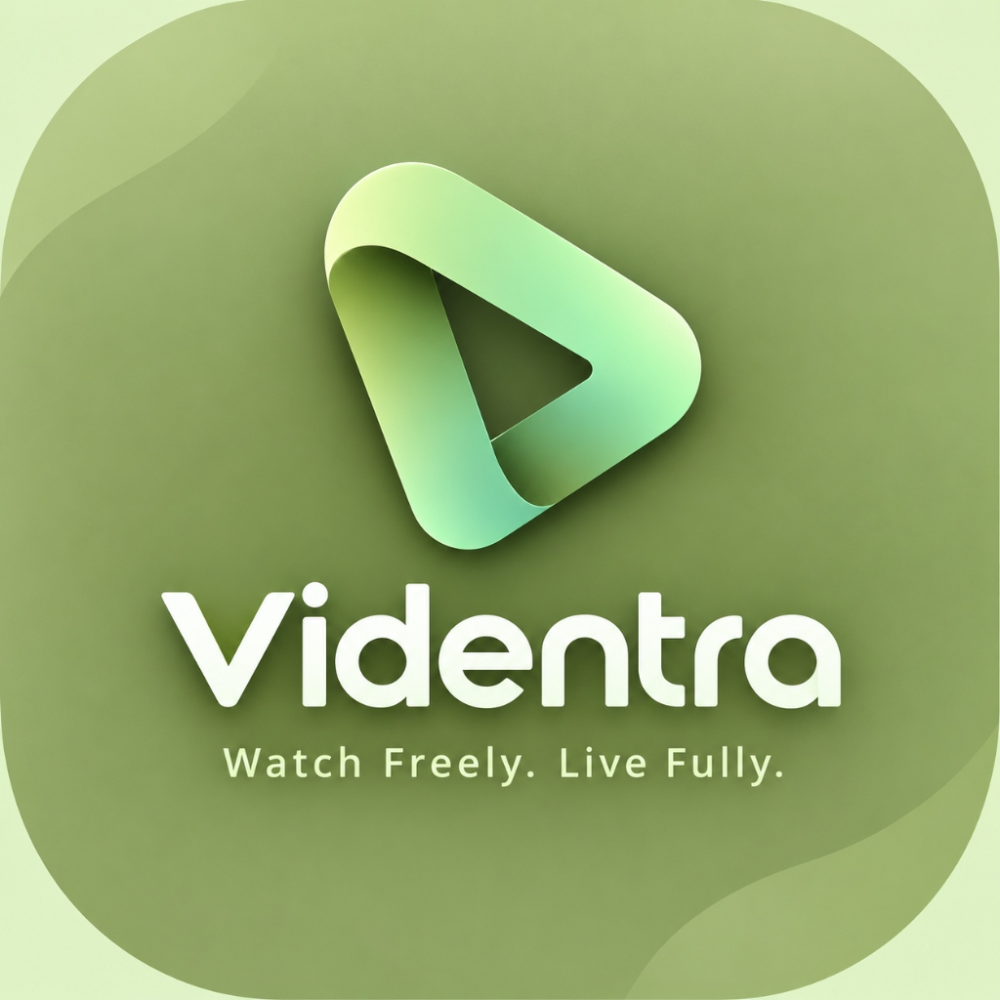
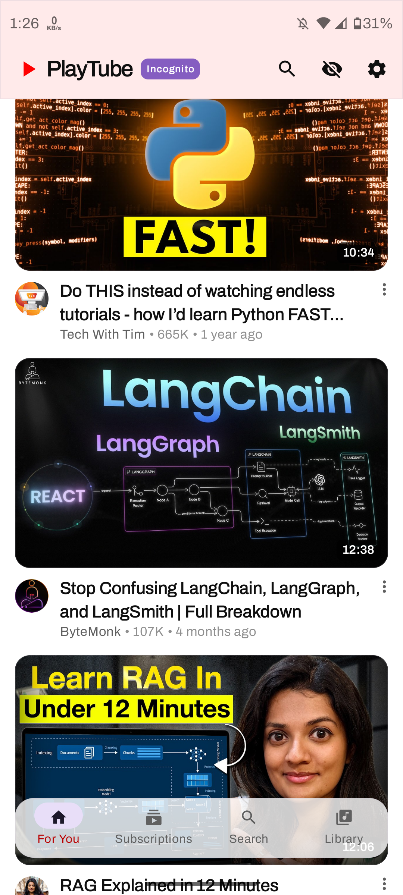
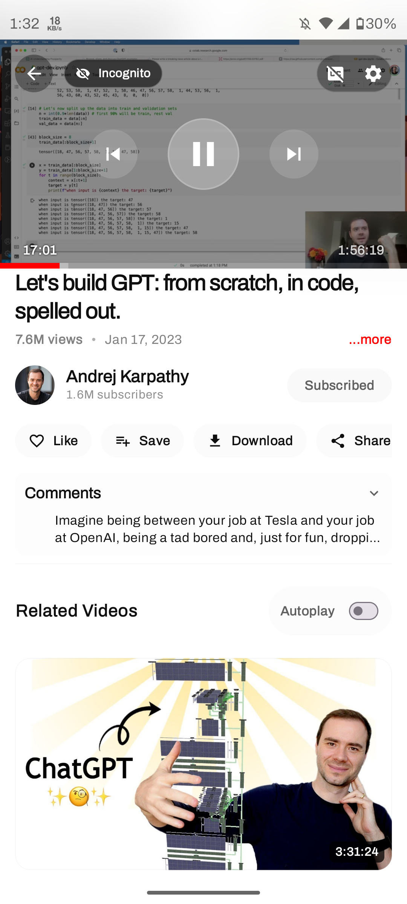
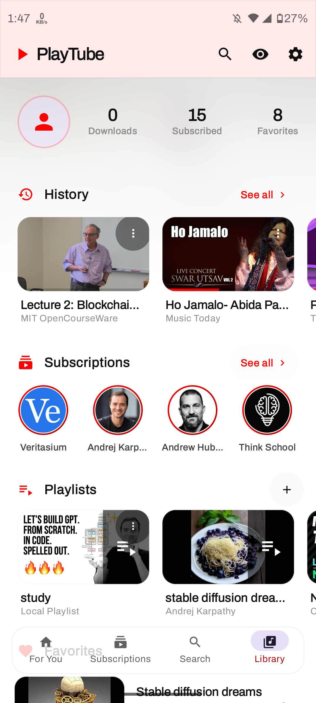
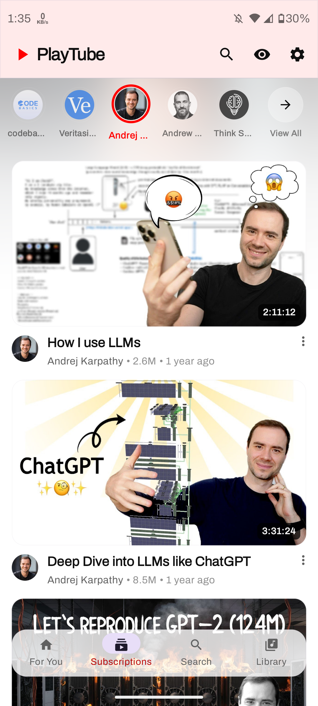
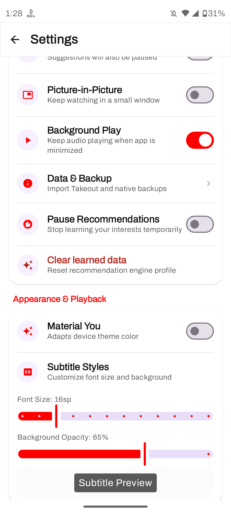
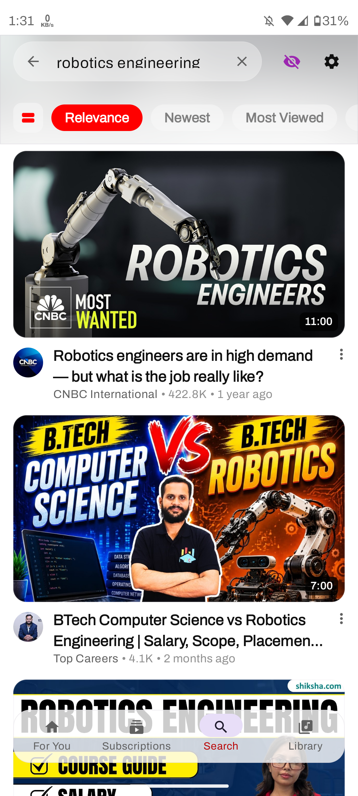

<div align="center">



# VIDENTRA

### *Watch Freely. Live Fully.*

A fast, private, ad-free, and feature-rich YouTube client for Android, engineered with modern Jetpack Compose and Material Design 3.

**No ads · No tracking · No Google Services required · 100% Privacy-First**

<br>

<p align="center">
  <a href="https://github.com/srivatsan2007/VIDENTRA---Watch-Freely.-Live-Fully/releases/latest">
    
  </a>
  <a href="https://github.com/srivatsan2007/VIDENTRA---Watch-Freely.-Live-Fully/stargazers">
    
  </a>
  <a href="https://github.com/srivatsan2007/VIDENTRA---Watch-Freely.-Live-Fully/network/members">
    
  </a>
  <a href="https://github.com/srivatsan2007/VIDENTRA---Watch-Freely.-Live-Fully/blob/main/LICENSE">
    
  </a>
  
  
</p>

<br>

<a href="https://github.com/srivatsan2007/VIDENTRA---Watch-Freely.-Live-Fully/releases/latest">
  
</a>

</div>

---

## 🌟 About Videntra

**VIDENTRA** is designed from the ground up for users who want total control over their media streaming experience without advertisements, telemetry, or Google Play Services dependencies. Built with state-of-the-art Android architecture, it combines sleek aesthetics, high performance, and deep customization.

---

## ✨ Key Features

### 🌈 YouTube-Style "Ambient Mode" (Dynamic Palette)
- **Video-Driven Background Glow:** As you watch videos, dominant and vibrant colors are extracted dynamically and cast a soft, luminous ambient glow behind the player, title, and comments.
- **Atmospheric Cross-Fade:** Smoothly cross-fades between color palettes over 850ms when transitioning between videos (e.g., deep aquatic cyan for ocean videos, warm orange/purple for sunsets).
- **Quick Controls:** Toggle on or off anytime via the player settings sheet or app appearance settings.

### 🛡️ Privacy & Zero Ads
- Complete freedom from banner ads, interstitial video ads, and sponsored tracking.
- No Google account or microG framework required to subscribe, bookmark, or create playlists.

### 🎧 Background Playback & Picture-in-Picture (PiP)
- Seamless audio playback when your screen is locked or while multitasking in other apps.
- Resizable Picture-in-Picture floating window with intuitive touch controls.

### ⚡ Fluid Modern Design
- Built entirely with **Jetpack Compose** and **Material Design 3**.
- Smooth spring physics, fluid gestures, swipe controls for volume/brightness, and immersive edge-to-edge support.

### 📥 High-Speed Offline Downloads
- Download video and audio streams up to full HD with multi-stream parallel acceleration and resume capabilities.

### 💬 Rich Interactive Community
- Read comments, expand replies, parse timestamps, and browse chapters with seamless navigation.

### 🕵️ Incognito & Data Control
- One-tap Incognito Mode to keep watch habits completely private.
- Clear search history, watch history, or learned recommendation data whenever you wish.

### 📺 YouTube-Style Fullscreen Mode
- **One-Tap Fullscreen:** Dedicated YouTube-style fullscreen toggle button (`⛶`) to seamlessly transition between portrait and edge-to-edge landscape playback.
- **Fluid Gestures:** Swipe up on the video to enter full screen; swipe down or press back to return to portrait without closing the video.
- **Dynamic Aspect Ratio:** Switch on-the-fly between Fit (16:9), Zoom to Fill (crops black bars on modern ultrawide screens), and Stretch.

---

## 📸 Screenshots

<div align="center">


&nbsp;

&nbsp;

&nbsp;

&nbsp;

&nbsp;


</div>

---

## 🛠️ Technology Stack

| Category | Technology | Purpose |
|---|---|---|
| **Language** | Kotlin (100%) | Modern, safe, expressive programming |
| **UI Framework** | Jetpack Compose | Modern declarative Android UI toolkit |
| **Design System** | Material Design 3 | Dynamic color schemes, fluid elevation, and typography |
| **Architecture** | MVVM + Clean Architecture | Strict separation of concerns (Data, Domain, UI) |
| **Concurrency** | Kotlin Coroutines & Flow | Asynchronous streams, StateFlow reactive bindings |
| **Media Playback** | AndroidX Media3 (ExoPlayer) | High-performance audio/video rendering |
| **Image Loading** | Coil 3 | Disk & memory caching, palette extraction |
| **Extraction Engine** | NewPipe Extractor | Lightweight, private stream metadata extraction |
| **Local Database** | Room DB & Jetpack DataStore | Encrypted local storage for history, likes, and settings |
| **Dependency Injection**| Dagger Hilt | Modular singleton and view model injection |
| **Networking** | OkHttp & Ktor | Robust HTTP streaming and background downloads |

---

## 👨‍💻 Contributor & Lead Developer

<div align="center">

### **SRIVATSAN R**
**Lead Developer & Maintainer**

[](https://github.com/srivatsan2007)
[](https://srivatsan-portfolio.vercel.app/)
[](https://github.com/srivatsan2007/VIDENTRA---Watch-Freely.-Live-Fully.git)

*Passionate Android & full-stack developer committed to creating beautiful, private, and high-performance digital experiences.*

</div>

---

## 🤝 Acknowledgements

Videntra is built upon the incredible work of the open-source community:
- [NewPipe & NewPipe Extractor](https://github.com/TeamNewPipe/NewPipe)
- [TeamNewPipe](https://github.com/TeamNewPipe)
- [LibreTube](https://github.com/libre-tube/LibreTube)
- [Android Open Source Project](https://source.android.com/)

---

## 📄 License

Videntra is licensed under the **[GNU General Public License v3.0 (GPL-3.0)](LICENSE)**.

```
VIDENTRA - Watch Freely. Live Fully.
Copyright (C) 2026 SRIVATSAN R

This program is free software: you can redistribute it and/or modify
it under the terms of the GNU General Public License as published by
the Free Software Foundation, either version 3 of the License, or
(at your option) any later version.
```
